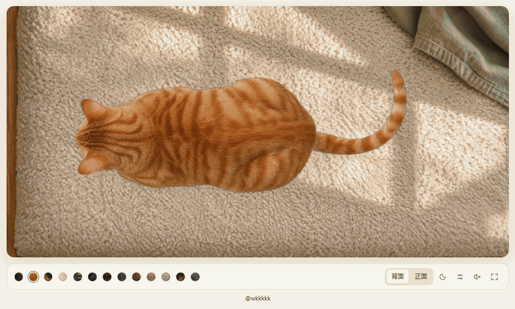
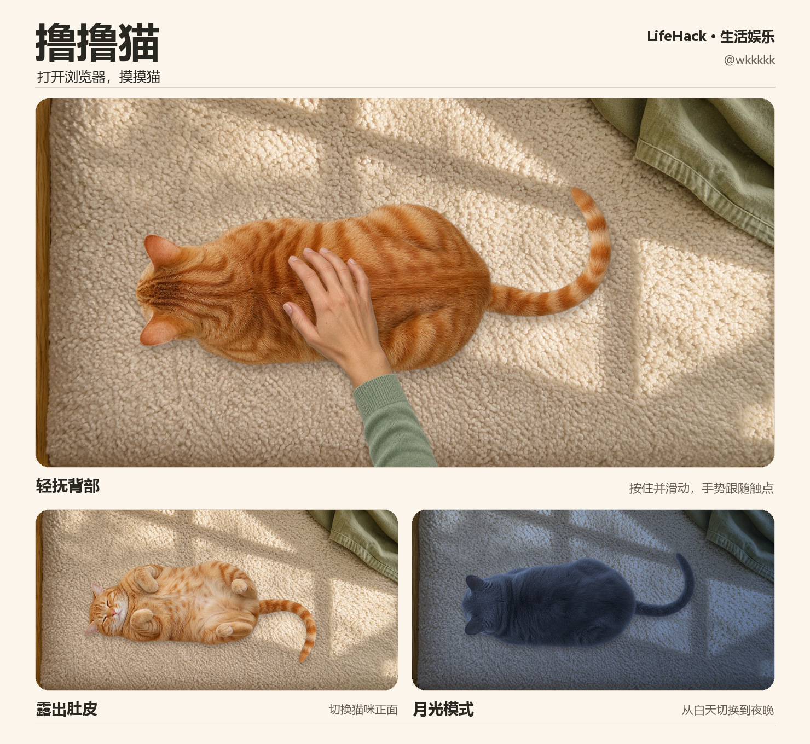

# 撸撸猫

猫咪抚摸网页。13 只猫各有独立的正面、背面和尾巴照片素材。支持日夜、体型、声音和全屏。

## 网页实机演示

按住滑动可以抚摸猫咪。摸到尾巴时，手势会变成轻握。向外拖能把尾巴拉直，松手后会卷回。演示还展示了翻身露肚皮和月光模式。点击动图即可打开网页。

[](https://wwlovekk.github.io/cloud-pet/)

## 项目效果图



## 在线体验

- [GitHub Pages 公开镜像](https://wwlovekk.github.io/cloud-pet/)
- [国内中文版 · Qoder Sites](https://cloud-pet-mggqe96sm0j.qoder.website/)
- [原海外版 · ChatGPT Sites](https://cloud-pet-yunjian-wk.swift-hill-4874.chatgpt.site/)（按原站分享权限访问）

## 启动

```powershell
pnpm install
pnpm dev
```

打开 `http://127.0.0.1:3000`。当前交互页面不请求业务 API，不依赖数据库和外部素材服务器。

## 当前实现

- 内置 imagegen 生成 13 张猫咪图集、两种手掌姿态与羊羔绒窗座背景。每张猫咪图集分别提供正面、背面和尾巴贴图。
- 按住滑动会造成局部下陷和顺逆毛变化，同时留下逐渐消散的毛痕。
- 从身体滑到尾部时，手掌会渐变为握姿。按住尾巴向外拖可把它拉直，松手后卷回。
- Web Audio 合成呼噜，随抚摸速度和部位调制，抚摸时偶尔响起轻声猫叫。默认静音，点击声音按钮开启。
- 浏览器保存毛色、视角、体型、日夜与静音偏好；键盘聚焦画布后可按空格轻抚、T 翻面、M 切换声音。

## 主要文件

```text
src/components/CloudPet.tsx              极简界面、指针、手掌、偏好
src/engine/rendering/PhotoCatRenderer.ts  照片网格、按压、呼吸、尾巴、翻面
src/engine/rendering/FurContact.ts       弹性按压和渐退毛流
src/engine/rendering/TailRig.ts          固定长度的尾巴骨架
src/engine/audio/ComfortAudio.ts          Web Audio 呼噜合成
src/config/photo-cats.ts                 猫咪选项和默认参数
src/app/globals.css                      参考图比例、日夜、工具栏和移动端
public/assets/photoreal/                 交互使用的透明 WebP 与窗座背景
docs/reference-study.md                  原站代码研究、素材来源与差异
docs/image-generation.md                 AI 图片路径、工具与完整提示词
```

此前实现的 API、Prisma Schema 和 Seed 继续保留在仓库中，当前首页不使用这些功能。若单独开发后端，可运行 `pnpm db:setup`；无需为当前页面初始化数据库。

## 构建

```powershell
pnpm typecheck
pnpm build
pnpm build:static
```

`build` 生成完整 Next.js 应用。`build:static` 用同一个 React 入口生成 `dist/`，供静态托管，所有照片随包部署，不依赖参考站在线运行。

推送到 `main` 后，GitHub Actions 构建并发布到 GitHub Pages。静态资源路径在构建时由 `PET_STATIC_BASE_PATH` 设置。

页脚的 [@wkkkkk](https://github.com/wwlovekk) 链接打开项目维护者的 GitHub 主页。视觉与交互参考见 [研究记录](docs/reference-study.md)。
